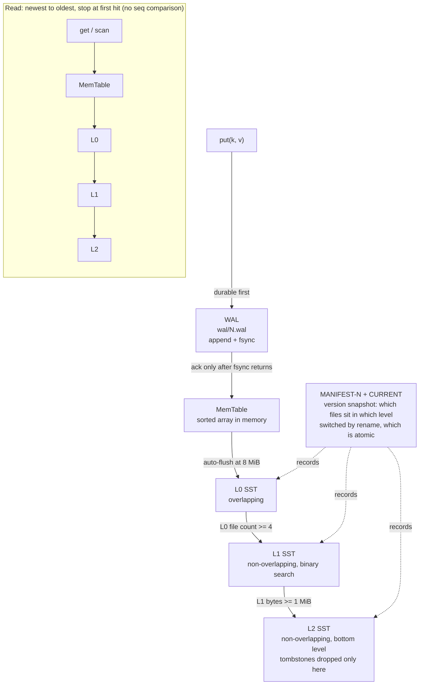

# moonlsm

**An embedded LSM-tree storage engine for the MoonBit ecosystem.**


> Community project, not an official MoonBit release. The `moon` prefix follows
> community naming convention (moondb / moonrpc / moongql).

[中文](README.md) · English

---

## Why this exists

Every KV store available for MoonBit today is **Bitcask**-shaped: one append-only
file plus a full in-memory index. Memory grows linearly with the dataset, and there
is no leveled compaction.

A real **LSM-tree** (memtable + SSTable + compaction) does not exist in MoonBit yet.

moonlsm fills that gap — and, just as importantly, **measures its crash consistency
instead of hand-waving it**. That is the part most individual implementations gloss
over.

---

## Design



What each of the three paths guarantees:

| Path | Property |
|---|---|
| Write | **fsync happens before ack, and before the MemTable is touched** — a failed write is completely invisible, so there is no window where a value is readable but vanishes on power loss |
| Read | Short-circuit from newest to oldest: return on the first hit, **without comparing `seq`**. This is why the in-memory file order must be strictly newest-first, determined solely by `version` |
| Compaction | Same key resolves to the **largest `seq`** (not to file order). Tombstones are dropped only when written into the bottom level — dropping them earlier would resurrect deleted data |

**Why three levels and not two**: with only `L0 + L1`, the predicate "is the
destination the bottom level" is always true, so the branch can never be falsified —
and the consequence of getting it wrong is *deleted data coming back*. With `L2`
present, both branches are actually exercised by the test suite. See
[ADR-0007](docs/adr/0007-compaction-levels-and-tombstones.md).

Byte layouts (WAL frames / data blocks / footer / MANIFEST) are in
[`docs/design/format.md`](docs/design/format.md); per-crash-point recovery paths
are documented in file headers and [ADR-0003](docs/adr/0003-crash-contract.md).

---

## Quick start

```bash
moon check                        # type check (zero warnings)
moon test                         # unit tests
moon build --target native        # build dbcli
moon run examples/basic           # run the minimal example
```

See it work in ten seconds (JSON lines over stdin; data directory comes from
`MOONLSM_DATA`):

```bash
printf '%s\n' \
  '{"op":"put","k":"user:1","v":"alice","sync":true}' \
  '{"op":"get","k":"user:1"}' \
  '{"op":"scan","start":"user:","end":"user;","limit":10}' \
  | MOONLSM_DATA=./data ./_build/native/debug/build/cmd/dbcli/dbcli.exe
```

```
{"ok":true,"seq":1}
{"ok":true,"v":"alice"}
{"ok":true,"items":[["user:1","alice"]]}
```

Run `{"op":"get","k":"user:1"}` again in a fresh process — the data is still there.
On disk you will see `CURRENT` / `MANIFEST-*` / `wal/<n>.wal` / `sst/<n>.sst`.

> **Status: Week 3.** WAL + MANIFEST + three-level compaction are all wired up:
> writes land in the WAL before ack, `kill -9` loses no acknowledged data
> (`crash_test.py --rounds 20` fully green), level membership is rebuilt from the
> MANIFEST on restart, L0 merges itself once it holds 4 files, and L1 sinks to
> L2 past 1 MiB. `model_check.py` ran 5,000 random steps with zero errors.
> Full acceptance procedure:
> [`docs/engineering/ACCEPTANCE.md`](docs/engineering/ACCEPTANCE.md); API contract:
> [`docs/design/API.md`](docs/design/API.md).

---

## API

```moonbit
// Real filesystem (data directory, memtable threshold)
let db = @moonlsm.Db::open(@moonlsm.NativeStorage::new("./data"), 8 * 1024 * 1024)!

let seq = db.put(b"key", b"value")!      // returning means it is already durable
let v = db.get(b"key")                   // Bytes?, deleted keys are None too
db.delete(b"key")!
let rows = db.scan(b"a", b"z", 100)!     // [start, end)
db.flush()!                              // memtable -> L0, triggers compaction if needed
db.close()

// In-memory backend: same API, so power-loss semantics are assertable inside `moon test`
let mem = @moonlsm.MemStorage::new()
let db2 = @moonlsm.Db::open(mem, 1 << 20)!

// Batched writes: one fsync per batch, `sync()` returning means the whole batch is durable
for i in 0..<200 { db.put_deferred(k, v)! }
db.sync()!
```

> **`put` and `put_deferred` differ in failure visibility**: `put` only mutates the
> memtable after fsync succeeds, so a failed write is invisible. `put_deferred`
> cannot offer that — when writing the first record it has no way to know whether
> the final `sync` will succeed. See ADR-0005.

---

## Capability matrix

| Capability | Status |
|---|---|
| Point read / write / delete | ✅ done |
| Range scan | ✅ done (half-open interval, k-way merge) |
| SSTable read/write (prefix compression + restart points) | ✅ done |
| Index / Bloom filter / footer | ✅ done |
| In-memory sorted table | ✅ done (sorted array; skiplist under evaluation in Week 3) |
| WAL crash recovery (torn tail does not panic) | ✅ done |
| Durability (restart / `kill -9` loses no acked data) | ✅ done |
| MANIFEST version snapshot + atomic CURRENT switch | ✅ done |
| Leveled compaction (L0 → L1 → L2, tombstones dropped only at the bottom) | ✅ done |
| Group commit (one fsync per `putmany` batch) | ✅ done |
| Concurrent reads/writes | not implemented (single-threaded, lock-free) |
| Background compaction thread | not implemented (runs synchronously at the end of `flush`) |
| Orphaned SST reclamation | not implemented |

### Explicitly out of scope

- **No transactions** (no MVCC, no snapshot isolation)
- **No compression** (SSTables are stored in plaintext)
- **No encryption, no authentication** (assumes single-process exclusive access to the directory)
- **No distribution** (this is an embedded library, not a database server)

Stating what a project will *not* do is more useful than listing what it might.

---

## Testing

Beyond `moon test`, there is an **external crash-consistency suite** (Python-driven,
talking to `cmd/dbcli` over a line-JSON protocol):

```bash
cd benches/python
python model_check.py --cmd "../../_build/native/debug/build/cmd/dbcli/dbcli.exe" --ops 2000 --restart-every 400
python crash_test.py   --cmd "../../_build/native/debug/build/cmd/dbcli/dbcli.exe" --rounds 20
python bench.py        --cmd "../../_build/native/release/build/cmd/dbcli/dbcli.exe" --n 1000000
```

The four scripts verify:

| Script | What it verifies |
|---|---|
| `model_check.py` | Differential test against an in-memory dict — overwrites, deletes, tombstones, large values, prefix keys |
| `crash_test.py` | **After `kill -9`, no acknowledged write is lost, and no half-written value is ever returned** |
| `bench.py` | Write throughput, read latency percentiles, range scan, space amplification |
| `bench_sqlite.py` | Same workload against SQLite, as an order-of-magnitude anchor |

`moon test` adds 180 unit tests, including 9 **corruption-injection** cases
(truncation / single-byte flip / missing file) and a byte-by-byte fuzz: for any
single corrupted byte in an SSTable, `Db::open` either succeeds or returns
`Corruption` — it never panics.

> The data directory is set by the `MOONLSM_DATA` environment variable (default
> `.moonlsm_data`), injected by `dbcli_launch.py` in all three scripts. There is no
> `--path` flag, and there never was.

---

## Performance

1,000,000 records, batches of 1,000, 100-byte values (Windows / NTFS / release build):

| Metric | Value |
|---|---|
| Sequential write | 50,212 ops/s (5.77 MB/s) |
| Random write (overwrite) | 12,724 ops/s (1.46 MB/s) |
| Read latency P50 / P95 / P99 | 0.068 / 0.113 / 0.147 ms |
| Range scan (500 rows per call) | 32,895 rows/s |
| Space amplification | 1.13× |

**Group commit is the number that matters here**: one fsync per 1,000 records means
`sync:true` is only 9% slower than `sync:false` (46,316 vs 50,806 ops/s). Drop the
batch size to 1 — one fsync per record — and sequential write falls from 3,103 to
**79** ops/s, a 39× collapse. SQLite under the same workload goes from 34,426 to
497 ops/s, the same order of magnitude, which says this is the physical cost of
fsync rather than an implementation problem.

Full data, including a metric-by-metric comparison against SQLite and the process of
locating each bottleneck, is in
[`docs/engineering/BENCHMARK.md`](docs/engineering/BENCHMARK.md).

> Note: `kill -9` kills the process but does not flush the OS page cache, so **it
> cannot detect a missing fsync**. Verifying fsync for real requires WAL tail
> truncation injection or a VM power-cut. See
> [`benches/python/README.md`](benches/python/README.md).

---

## Roadmap

| Version | Goal |
|---|---|
| ✅ v0.1.0 | Competition release: crash 20/20, model_check 5,000 steps with 0 errors |
| ✅ v0.2.0 | Embeddable: API freeze draft, runnable examples, all three backends build, published to mooncakes |
| v0.3.0 | Observable: stats/metrics, reproducible benchmarks |
| v0.5.0 | API frozen: semantic-versioning commitment, migration guide |
| v1.0.0 | Product: multi-backend abstraction, performance regression gates, external users |

The development model (why a gated incremental V-model rather than pure waterfall),
naming rationale, reference tiering, and the four-stage project-to-product
progression are all in
[`docs/engineering/PROCESS.md`](docs/engineering/PROCESS.md).

**What this library is supposed to do, and how we verify it does so** — see
[`docs/engineering/ACCEPTANCE.md`](docs/engineering/ACCEPTANCE.md), a five-gate
acceptance manual.

---

## References

| Purpose | Project |
|---|---|
| Primary template (read end to end) | [mini-lsm](https://github.com/skyzh/mini-lsm) |
| Look up implementation details | [goleveldb](https://github.com/syndtr/goleveldb) |
| Engineering quality bar (tests only) | [Pebble](https://github.com/cockroachdb/pebble) |
| File format reference | [LevelDB](https://github.com/google/leveldb) |
| Cautionary tales (three real bugs) | [Badger](https://github.com/dgraph-io/badger) |
| Prior art in MoonBit | [moonkv](https://mooncakes.io/docs/wallll-wal6/moonkv) · [moonjournalkit](https://mooncakes.io/docs/Sxy11112/moonjournalkit) |

Key decisions are recorded in [`docs/adr/`](docs/adr/); how each reference tier is
used is described in [`docs/engineering/PROCESS.md`](docs/engineering/PROCESS.md) §2.

## License

MIT — see [LICENSE](LICENSE).
