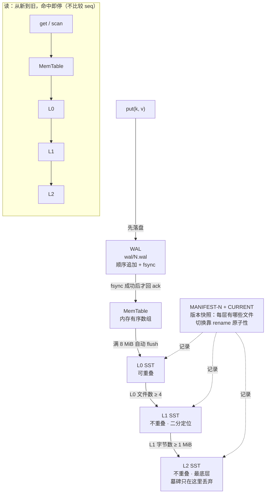

# moonlsm

**MoonBit 生态里的嵌入式 LSM 存储引擎。**


> 社区项目，非 MoonBit 官方出品。`moon` 前缀只是沿用社区命名惯例（moondb / moonrpc / moongql）。

中文 · [English](README.en.md)

---

## 为什么存在

MoonBit 生态里现有的 KV 存储都是 **Bitcask** 风格：一个追加文件 + 一份全量内存索引。数据量一大，内存就随数据线性增长，也没有分层合并。

真正的 **LSM-tree**（memtable + SSTable + compaction）在 MoonBit 里还是空白。

moonlsm 要做的，就是把这个空白补上——而且**把崩溃一致性测明白**，这是大多数个人实现最容易含糊过去的地方。

---

## 设计



三条路径各自的要点：

| 路径 | 关键性质 |
|---|---|
| 写 | **fsync 在返回 ack 之前**，且 fsync 在改 MemTable 之前 —— 失败时写入完全不可见，不会出现「读得到、断电就没」的脏读 |
| 读 | 从新到旧短路：命中第一个就返回，**不比较 seq**。所以内存里的文件顺序必须严格「新在前」，由 `version` 唯一决定 |
| 归并 | 同一 key 取 **`seq` 最大**的那条（不是按文件顺序）。墓碑只在写进最底层时丢弃 —— 上层还有更旧版本时丢了会让数据复活 |

**为什么是三层而不是两层**：只有 `L0 + L1` 时，「目标层是不是最底层」恒为真，
这个判定永远不会被证伪 —— 而它判错的后果是「删掉的数据复活」。
加了 L2 之后，两条分支都能在测试里真实走到。详见
[ADR-0007](docs/adr/0007-compaction-levels-and-tombstones.md)。

字节布局（WAL 帧 / data block / footer / MANIFEST）见
[`docs/design/format.md`](docs/design/format.md)；
崩溃点的恢复路径见各文件头的注释与 [ADR-0003](docs/adr/0003-crash-contract.md)。

---

## 快速开始

```bash
moon check                        # 类型检查（零警告）
moon test                         # 单元测试
moon build --target native        # 构建 dbcli
```

十秒看到它在工作（管道喂 JSON，数据目录由 `MOONLSM_DATA` 指定）：

```bash
printf '%s\n' \
  '{"op":"put","k":"user:1","v":"alice","sync":true}' \
  '{"op":"get","k":"user:1"}' \
  '{"op":"scan","start":"user:","end":"user;","limit":10}' \
  | MOONLSM_DATA=./data ./_build/native/debug/build/cmd/dbcli/dbcli.exe
```

```
{"ok":true,"seq":1}
{"ok":true,"v":"alice"}
{"ok":true,"items":[["user:1","alice"]]}
```

再跑一次 `{"op":"get","k":"user:1"}` —— 换成新进程，数据还在。
磁盘上会看到 `CURRENT` / `MANIFEST-*` / `wal/<n>.wal` / `sst/<n>.sst`。

> **当前进度：Week 2 完成。** WAL + MANIFEST + 三层 compaction 全部打通：
> 写入先落 WAL 再 ack，`kill -9` 不丢已确认数据（`crash_test.py --rounds 20` 全绿），
> 重启后层信息从 MANIFEST 恢复，L0 攒够 4 个文件自动归并、L1 超过 1 MiB 自动下沉。
> 完整的验收步骤见 [`docs/engineering/ACCEPTANCE.md`](docs/engineering/ACCEPTANCE.md)。

---

## API

```moonbit
// 真文件系统（数据目录、memtable 阈值）
let db = @moonlsm.Db::open(@moonlsm.NativeStorage::new("./data"), 8 * 1024 * 1024)!

let seq = db.put(b"key", b"value")!      // 返回即代表已落盘（fsync 已成功）
let v = db.get(b"key")                   // Bytes?，删除也是 None
db.delete(b"key")!
let rows = db.scan(b"a", b"z", 100)!     // [start, end)
db.flush()!                              // memtable -> L0，必要时触发归并
db.close()

// 内存后端：同一套 API，断电语义可以在 `moon test` 里直接断言
let mem = @moonlsm.MemStorage::new()
let db2 = @moonlsm.Db::open(mem, 1 << 20)!

// 批量写：一批只 fsync 一次，`sync()` 返回即代表整批已落盘
for i in 0..<200 { db.put_deferred(k, v)! }
db.sync()!
```

> **`put` 与 `put_deferred` 的失败可见性不同**：`put` 在 fsync 成功之后才改
> memtable，失败时写入完全不可见；`put_deferred` 做不到这一点（写第一条时
> 无法预知最后的 `sync` 会不会成功）。详见 ADR-0005。

---

## 能力矩阵

| 能力 | 状态 |
|---|---|
| 点查 / 写入 / 删除 | ✅ 已实现 |
| 范围扫描 | ✅ 已实现（左闭右开，多路归并） |
| SSTable 读写（前缀压缩 + restart point） | ✅ 已实现 |
| 索引 / Bloom filter / footer | ✅ 已实现 |
| 内存有序表 | ✅ 已实现（有序数组，Week 3 视性能换跳表） |
| WAL 崩溃恢复（尾部截断不 panic） | ✅ 已实现 |
| 持久化（进程重启 / `kill -9` 不丢已 ack 数据） | ✅ 已实现 |
| MANIFEST 版本快照 + CURRENT 原子切换 | ✅ 已实现 |
| 分层 compaction（L0 → L1 → L2，墓碑只在最底层丢弃） | ✅ 已实现 |
| 组提交（`putmany` 一批一次 fsync） | ✅ 已实现 |
| 并发读写 | 未实现（单线程，无锁） |
| 后台 compaction 线程 | 未实现（在 `flush` 末尾同步执行） |
| 孤儿 SST 回收 | 未实现 |

### 明确不做

- **不做事务**（无 MVCC、无快照隔离）
- **不做压缩**（SSTable 明文存储）
- **不做加密、不做鉴权**（假定单进程独占目录）
- **不做分布式**（这是嵌入式库，不是数据库服务）

把「不做什么」写清楚，比列一堆「计划做什么」更有用。

---

## 测试

除了 `moon test`，还有一套**外部崩溃一致性测试**（Python 驱动，通过 `cmd/dbcli` 的行 JSON 协议对接）：

```bash
cd benches/python
python model_check.py --cmd "../../_build/native/debug/build/cmd/dbcli/dbcli.exe" --ops 2000 --restart-every 400
python crash_test.py   --cmd "../../_build/native/debug/build/cmd/dbcli/dbcli.exe" --rounds 20
python bench.py        --cmd "../../_build/native/release/build/cmd/dbcli/dbcli.exe" --n 1000000
```

四个脚本分别验证：

| 脚本 | 验证什么 |
|---|---|
| `model_check.py` | 与内存 dict 逐条对拍，覆盖覆盖写 / 删除 / 墓碑 / 大 value / 前缀 key |
| `crash_test.py` | **kill -9 后，已确认的写入一条不丢，且绝不读出半个值** |
| `bench.py` | 写吞吐、读延迟分位、范围扫描、空间放大 |
| `bench_sqlite.py` | 同 workload 跑一遍 SQLite，给上面的数字一个数量级锚点 |

`moon test` 里另有 180 条单元测试，包括 9 条**损坏注入**用例（截断 / 单字节
翻转 / 文件缺失）和一条逐字节 fuzz：SST 里任何一个字节坏掉，
`Db::open` 要么成功、要么报 `Corruption`，绝不 panic。

> 数据目录由 `MOONLSM_DATA` 环境变量指定（默认 `.moonlsm_data`），
> 三个脚本统一用 `dbcli_launch.py` 注入，不需要也不支持 `--path` 参数。

---

## 性能

100 万条、每批 1000 条、value 100 字节（Windows / NTFS / release 构建）：

| 指标 | 数值 |
|---|---|
| 顺序写 | 50 212 ops/s（5.77 MB/s） |
| 随机写（覆盖写） | 12 724 ops/s（1.46 MB/s） |
| 读延迟 P50 / P95 / P99 | 0.068 / 0.113 / 0.147 ms |
| 范围扫描（每次 500 行） | 32 895 rows/s |
| 空间放大 | 1.13× |

**组提交是这里最关键的一个数**：每批 1000 条只 fsync 一次，所以
`sync:true` 只比 `sync:false` 慢 9%（46 316 vs 50 806 ops/s）；
而如果把批次改成 1（每条都等 fsync），顺序写从 3 103 掉到 **79** ops/s ——
39 倍。同样的 workload 下 SQLite 从 34 426 掉到 497 ops/s，量级一致，
说明这是 fsync 的物理成本，不是实现问题。

完整数据（含与 SQLite 的逐项对照、以及每一处瓶颈的定位过程）见
[`docs/engineering/BENCHMARK.md`](docs/engineering/BENCHMARK.md)。

> 注意：`kill -9` 只杀进程、不清 OS 页缓存，所以**它测不出「忘了 fsync」**。
> 真正验证 fsync 需要 WAL 尾部截断注入或虚拟机断电。详见 [`benches/python/README.md`](benches/python/README.md)。

---

## 路线图

| 版本 | 目标 |
|---|---|
| v0.1.0 | 比赛版：crash 20/20、model_check 5000 步 0 错、发布到 mooncakes |
| v0.2.0 | 可嵌入：API 冻结草案、examples 可跑、三后端构建通过 |
| v0.3.0 | 可观测：stats/metrics、bench 可复现 |
| v0.5.0 | API 冻结：语义化版本承诺、迁移指南 |
| v1.0.0 | 产品：多后端抽象、性能回归门禁、外部用户 |

开发模型（为什么用门禁式增量 V 模型，而不是纯瀑布）、命名考究、参考对象分层、
项目→产品四阶段演进，都在 [`docs/engineering/PROCESS.md`](docs/engineering/PROCESS.md)。

**「这个库要干什么、怎么验证它做对了」** 看
[`docs/engineering/ACCEPTANCE.md`](docs/engineering/ACCEPTANCE.md) —— 五关验收手册。

---

## 参考

| 用途 | 项目 |
|---|---|
| 主模板（通读） | [mini-lsm](https://github.com/skyzh/mini-lsm) |
| 查代码细节 | [goleveldb](https://github.com/syndtr/goleveldb) |
| 对标工程质量（只抄测试） | [Pebble](https://github.com/cockroachdb/pebble) |
| 查文件格式 | [LevelDB](https://github.com/google/leveldb) |
| 反面教材（三个真实 bug） | [Badger](https://github.com/dgraph-io/badger) |
| 同类竞品 | [moonkv](https://mooncakes.io/docs/wallll-wal6/moonkv) · [moonjournalkit](https://mooncakes.io/docs/Sxy11112/moonjournalkit) |

关键决策记录在 [`docs/adr/`](docs/adr/)，每层参考怎么用见
[`docs/engineering/PROCESS.md`](docs/engineering/PROCESS.md) §2。

## License

MIT —— 见 [LICENSE](LICENSE)。
