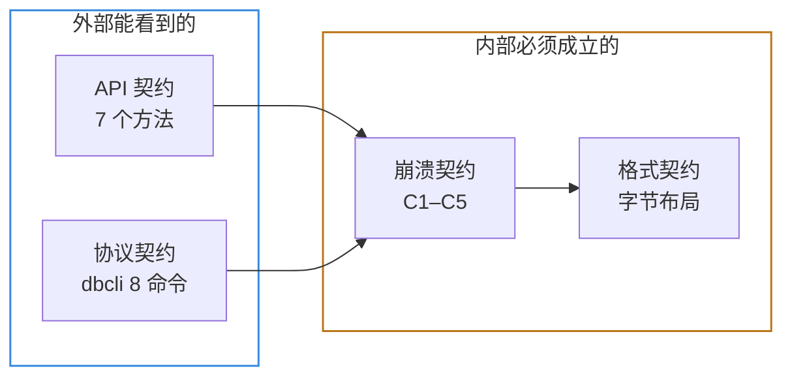

# 验收手册：这个库干什么，怎么证明它做对了

> 这份文档解决一个很具体的困惑：**「我知道我在写一个 LSM 引擎，但我不知道什么样的状态算写完了。」**
>
> 全文只回答三个问题：
> 1. 这个库到底要干什么（能用 15 行代码说清）
> 2. 「标准」是什么（四份文件，不是模糊的「好用」）
> 3. 怎么验证（五关，每关一条命令 + 期望输出 + 失败说明什么）

---

## 1. 这个库到底要干什么

### 1.1 一句话

> **把「往磁盘上存键值对」这件事，做得像操作一个 `Map` 一样简单，但断电之后已确认的数据还在。**

### 1.2 用户视角：这就是全部

```moonbit
let db = @moonlsm.open("./mydata", opts)

db.put(b"user:1", b"alice")
db.put(b"user:2", b"bob")
db.delete(b"user:1")

db.get(b"user:2")                    // Some(b"bob")
db.get(b"user:1")                    // None
db.scan(b"user:", b"user;", 100)     // [(user:2, bob)]

db.close()
```

没有 SQL，没有表结构，没有事务，没有索引设计。**只有一个 key 换一个 value。**

### 1.3 和三个熟悉的东西对比

这是理解它最快的方式——看它比每个东西多了什么、少了什么：

| 对比对象 | 它多了什么 | 它少了什么 |
|---|---|---|
| `Map[Bytes, Bytes]`（内存字典） | **数据在磁盘上**，进程退出、断电都不丢（已确认的部分） | 内存访问速度（差 3–5 个数量级） |
| 手写 `fwrite` 追加文件 | 能**删除**（墓碑）、能**范围查询**（scan）、**崩溃后能自动恢复**到一致状态、内存不随数据量线性增长 | 简单（写 `fwrite` 是 20 行，写这个引擎是 5000 行） |
| SQLite | 写吞吐高（顺序追加 vs B+ 树随机写）、无固定 schema、代码量小到能读懂 | SQL、事务、二级索引、并发多写、成熟度 |

**这张表最后一行是关键**：你的价值不在「存数据」，而在「高写吞吐 + 崩溃安全 + 内存可控」这三件事的组合。评审和用户只为这个组合付钱。

### 1.4 它为什么需要这么复杂（LSM 的核心思想）

如果只是「存进去、读出来」，一个追加文件就够了。LSM 存在的唯一理由是：

> **把随机写变成顺序写。**

磁盘（尤其是 HDD 和廉价 SSD）顺序写比随机写快一到两个数量级。但用户要的是「任意 key 随时可写」，这天然是随机的。

LSM 的解法是**分层缓冲**：

```
用户写 → WAL（顺序追加，快）→ MemTable（内存有序表）
                                    ↓ 满了就刷
                              L0 SST（磁盘上的有序文件）
                                    ↓ 层数/大小超阈值就合并
                              L1 → L2 → ...（越往下越大、越有序）
```

读的时候从上往下找：MemTable → L0 → L1 → L2。为了避免「每个文件都打开看一眼」，用 Bloom Filter 先排除「肯定不在这里」的文件。

**所以这个库的工作量集中在四件事上**，其余都是胶水：

| 组件 | 解决什么问题 | 不做会怎样 |
|---|---|---|
| **WAL** | 内存里的数据断电就没了 | 崩溃丢数据 |
| **MemTable + SST** | 内存装不下全部数据 | 数据量一大就 OOM |
| **Compaction** | SST 越积越多，读要扫的文件越来越多 | 读越来越慢，空间放大失控 |
| **Bloom Filter** | 每次读都要打开一堆文件 | 读放大 10 倍以上 |

---

## 2. 「标准」是什么

「符合标准」不是感觉，是**四份文件的逐条对应**。每份文件都是一类契约：

| # | 契约 | 文件 | 管什么 | 谁来检查 |
|---|---|---|---|---|
| 1 | **API 契约** | `PLAN.md` §3 | 对外只暴露 7 个方法 | 人工看 `.mbti` |
| 2 | **协议契约** | `benches/python/README.md` | dbcli 的 8 个命令与 JSON 格式 | 测试脚本 |
| 3 | **崩溃契约** | `docs/adr/0003-crash-contract.md` | C1–C5：什么必不丢、什么可以丢 | `crash_test.py` |
| 4 | **格式契约** | `docs/design/format.md` | 磁盘上每个字节是什么 | 代码评审 + 读回测试 |

### 2.1 这四份契约的关系



**验证的顺序正好相反**：从外往里验。因为外部行为错了，内部一定有问题；内部格式错了，外部行为可能暂时看不出来（直到崩溃）。

### 2.2 最容易误解的一点

> **「测试通过」≠「符合标准」。**

具体例子：`model_check.py` 全绿只证明「语义对」，不证明「崩溃不丢数据」。
反过来，`crash_test.py` 全绿也不证明「scan 的边界处理对」。

这就是为什么验收要**分五关**，而不是一个「全绿」就完事。

---

## 3. 怎么验证：五关

**设计原则**：越便宜的关越先跑；每关失败时的信息要能直接指向问题位置。

### 关卡总览

| 关 | 名称 | 耗时 | 验什么 | 命令 |
|---|---|---|---|---|
| **L0** | 编译与类型 | 秒级 | 语法、类型、废弃 API | `moon check --deny-warn` |
| **L1** | 单元测试 | 秒级 | 单个函数的逻辑 | `moon test` |
| **L2** | 协议连通 | 秒级 | dbcli 是否接上了真引擎 | `probe_persistence.py` |
| **L3** | 语义对拍 | 十秒级 | 读写删扫描的语义 | `model_check.py` |
| **L4** | 崩溃一致性 | 分钟级 | 持久化契约 C1–C5 | `crash_test.py` |
| **L5** | 性能基准 | 分钟级 | 吞吐、延迟、空间放大 | `bench.py` |

---

### L0 · 编译与类型

```bash
moon check --deny-warn
```

**期望**：`Finished. moon: ran N tasks, now up to date`，**没有任何 Warning**，退出码 0。

**不过说明什么**：语法或类型错误；或者用了已废弃的 API（`--deny-warn` 会把 warning 当错误）。

**为什么要求零警告**：存储引擎里「废弃 API 的警告」往往伴随语义变化。比如 `String::to_bytes` 被废弃、`String::compare` 的语义是长度优先而非字节序——这类东西不看警告就会踩坑。

---

### L1 · 单元测试

```bash
moon test
```

**期望**：`Total tests: N, passed: N, failed: 0`。

**不过说明什么**：某个函数自己的逻辑错了。看失败的那条测试名字就知道是哪个模块。

**当前状态**：16 个测试，全绿。

---

### L2 · 协议连通（关键关卡）

```bash
cd benches/python
python probe_persistence.py --cmd "../../_build/native/debug/build/cmd/dbcli/dbcli.exe"
```

**期望三种退出码，含义完全不同**：

| 退出码 | 输出 | 含义 | 该做什么 |
|---|---|---|---|
| `0` | `OK: 重启后数据仍在` | 已支持持久化 | 可以进 L3 / L4 |
| `1` | `SKIP: 重启后数据丢失` | **尚未支持持久化**（内存占位） | 正常，去写 WAL |
| `2` | `FAIL: 无法启动 dbcli` | dbcli 本身坏了 | 修 dbcli，这不是「还没实现」 |

**为什么单独设这一关**：M0/M1 阶段跑 L4 必然全红。如果直接跑，会训练出「CI 红着也无所谓」的习惯——那比没有 CI 更危险。所以显式探测、显式跳过。

**当前状态**：退出码 `0`（WAL 已接通）。L2 通过之后，L3 的 `--restart-every`
才真正开始起作用 —— 之前它只能验证「不重启时语义对不对」。

---

### L3 · 语义对拍

```bash
cd benches/python
python model_check.py \
  --cmd "../../_build/native/debug/build/cmd/dbcli/dbcli.exe" \
  --ops 2000 --restart-every 500 --seed 20261021
```

**期望**：`错误 0` + `结论: PASS`。

**它怎么工作的**：用一个 Python `dict` 当「标准答案」，随机生成 put / del / get / scan 操作，每步都比对你的引擎和 dict 的结果。`--restart-every 500` 表示每 500 步重启一次引擎，验证重启后数据还在。

**不过说明什么**：

| 失败信息 | 说明什么 |
|---|---|
| `get 不一致` | 读路径错（memtable/SST 查找、墓碑处理） |
| `scan key 集合不一致` | 范围边界错（**注意：必须用字节序比较**） |
| `重启后不一致` | WAL 重放或 MANIFEST 恢复错 |

**当前状态**：`--ops 2000 --restart-every 400`，5 次重启，错误 0。

---

### L4 · 崩溃一致性（最核心的一关）

```bash
cd benches/python
python crash_test.py \
  --cmd "../../_build/native/debug/build/cmd/dbcli/dbcli.exe" \
  --rounds 20 --seed 20261021
```

**期望**：`20/20 轮通过` + `结论: PASS`。

**当前状态**：20/20 通过（两个种子各 10 轮），每轮写入 2.7 万–6.5 万条，
`丢失 0`、`半条 0`。

**它怎么工作的**：写入并等响应（记入「已确认」集合）→ 再发一批不等响应 → `kill -9` → 重启 → 逐条校验。已确认的必须全在，且值完全正确；未确认的允许丢，但**不能读出半条**。

**不过说明什么**：

| 失败信息 | 说明什么 |
|---|---|
| `已确认的写入丢失` | **fsync 没做**，或 ack 发在 fsync 之前，或 WAL 重放漏了 |
| `读出了不完整的值` | 恢复时没处理尾部截断（torn write） |
| 进程启动不了 | 恢复路径 panic 了，违反不变量 I3 |

**⚠️ 必须知道的一件事**：

> `kill -9` **测不出「忘了 fsync」**。

它只杀进程，不清空操作系统页缓存。所以一个完全忘记 `fsync` 的实现，照样能通过 `kill -9` 测试。真正能暴露这个问题的是**WAL 尾部截断注入**和**虚拟机断电**。详见 `docs/adr/0003-crash-contract.md` 的测试分层 L1–L4。

**不要拿「kill -9 全绿」当「持久化正确」的证据。** 这是本项目最容易被误解、也最值得在答辩时主动讲清的一点。

---

### L5 · 性能基准

```bash
cd benches/python
python bench.py \
  --cmd "../../_build/native/release/build/cmd/dbcli/dbcli.exe" \
  --n 100000 --reads 20000
```

**期望**：输出顺序写吞吐、随机写吞吐、读延迟 P50/P95/P99、范围扫描、空间放大。

**这一关不阻塞正确性**，但决定「能不能拿去用」。要报告两组数据：`sync:true` 和 `sync:false`。**只报快的那个是误导**——两者差一个数量级是物理限制，不是实现问题。

---

## 4. 十秒手工验证（最快的直觉建立）

不想跑脚本时，直接用管道喂 JSON，亲眼看它在工作：

```bash
printf '%s\n' \
  '{"op":"put","k":"user:1","v":"alice","sync":true}' \
  '{"op":"put","k":"user:2","v":"bob","sync":true}' \
  '{"op":"get","k":"user:2"}' \
  '{"op":"del","k":"user:1","sync":true}' \
  '{"op":"get","k":"user:1"}' \
  '{"op":"scan","start":"user:","end":"user;","limit":10}' \
  '{"op":"stats"}' \
  | MOONLSM_DATA=./data ./_build/native/debug/build/cmd/dbcli/dbcli.exe
```

**实测输出**（Week 2 完成时的真落盘实现）：

```
{"ok":true,"seq":1}
{"ok":true,"seq":2}
{"ok":true,"v":"bob"}
{"ok":true,"seq":3}
{"ok":true,"v":null}
{"ok":true,"items":[["user:2","bob"]]}
{"ok":true,"live_keys":1,"wal_bytes":63,"ssts":0,"flushes":0,"mem_entries":2,"levels":[0,0,0]}
```

**逐行读**：

| 行 | 含义 |
|---|---|
| 1–2 | 两次 put 成功，分配了 seq 1 和 2 |
| 3 | `get user:2` 拿到 `bob` |
| 4 | `del user:1` 成功，seq 3 |
| 5 | `get user:1` 返回 `null` —— **删除生效** |
| 6 | `scan` 只剩 `user:2`，且**按字节序**返回 |
| 7 | `live_keys: 1` 与预期一致；`wal_bytes: 63` 说明三条记录都在 WAL 里、还没刷 SST；`levels: [0,0,0]` 说明三层都是空的 |

再跑一次（新进程，同样的 `MOONLSM_DATA`）：

```bash
printf '%s\n' '{"op":"get","k":"user:2"}' | MOONLSM_DATA=./data ./_build/native/debug/build/cmd/dbcli/dbcli.exe
# {"ok":true,"v":"bob"}
```

数据还在 —— 这条才是 Week 2 的真正交付。磁盘上会看到：

```
data/CURRENT            # 只有一行：MANIFEST-000002
data/MANIFEST-000002    # 版本快照（层信息、WAL 编号、下一个可用编号）
data/wal/000001.wal     # 未刷盘的写入
data/sst/               # 已刷盘的 SST（这里还没 flush，所以是空的）
```

**看 compaction 在工作**（写满 4 个 L0 文件，L1 再超 1 MiB）：

```bash
# 每轮 putmany 3000 条 + flush，跑 6 轮，每轮看一次 stats
# 实测 levels 的变化：[1,0,0] → [2,0,0] → [3,0,0] → [0,0,2] → [1,0,2] → [2,0,2]
```

第 4 轮 L0 攒够 4 个文件触发归并，输出进 L1 后又因为超过 1 MiB 直接沉到 L2 ——
一次 flush 里做了两级归并。驱动脚本见 `benches/python/`，也可以用
`dbcli` 的 `{"op":"flush"}` 手工复现。

---

## 5. 我现在在第几关？

对照这张表自查：

| 现象 | 你在哪 | 下一步 |
|---|---|---|
| `moon check` 有报错 | L0 之前 | 修语法/类型 |
| `moon test` 有红 | L0–L1 | 修对应模块的函数 |
| `probe_persistence.py` 返回 `1` | L2 | 写 `wal.mbt` + `manifest.mbt`，把 dbcli 换成真 `Db` |
| `probe` 返回 `0`，`model_check` 有错 | L3 | 修读写删扫描语义 |
| `model_check` 全绿，`crash_test` 有红 | L4 | 修 fsync 顺序与恢复逻辑 |
| L4 全绿 | **L1–L4 全通**（当前状态） | 跑 L5 出数据，写 README 的 benchmark 表 |

---

## 6. 参考库在哪（8 个位置）

按用途分三类。**不要都读**——先读 A 类建立定位，再读 B 类学结构，C 类只在需要时查。

### A. 同类竞品（MoonBit 生态，必须先看）

| 项目 | 位置 | 定位 | 你看什么 |
|---|---|---|---|
| **moonkv** | [mooncakes](https://mooncakes.io/docs/wallll-wal6/moonkv) · [GitHub](https://github.com/wallll-wal6/MoonKV) | **Bitcask 架构**，Apache-2.0，33 次下载 | 它的 API 长什么样（这决定了 MoonBit 用户的预期）；它的**局限**在哪（Bitcask 全量索引放内存，数据量一大就爆）——这就是你的差异点 |
| **moonjournalkit** | [mooncakes](https://mooncakes.io/docs/Sxy11112/moonjournalkit) | 只做 WAL 分帧与崩溃恢复，23 次下载 | 它的 WAL 帧格式怎么设计的；和你的 `format.md` §2 有什么不同。**它只做了一层，你做完整引擎** |

**为什么这两个必须先看**：它们定义了「MoonBit 生态里已有什么」。你的申报书里必须能回答「为什么还需要你」。答案就在它们的架构局限上——Bitcask 不是 LSM，WAL 库不是存储引擎。

### B. 学结构（其他语言，主模板）

| 项目 | 位置 | 定位 | 你看什么 |
|---|---|---|---|
| **mini-lsm** ⭐ | [github.com/skyzh/mini-lsm](https://github.com/skyzh/mini-lsm) | **主模板**。Rust，3k 行，按周分章教程，有 starter code | **通读**。每周开始前读对应章节。这是唯一需要通读的项目 |
| **goleveldb** | [github.com/syndtr/goleveldb](https://github.com/syndtr/goleveldb) | LevelDB 的 Go 1:1 移植 | **按需跳读**。卡住时只看当前在写的那个文件。Go 的 GC 模型接近 MoonBit，比读 C++ 省力 |

**不能从 mini-lsm 抄什么**：`Arc` / `RwLock` / `Send + Sync` / 生命周期标注 / `crossbeam_skiplist` / `bytes::Bytes` 零拷贝。这些是 Rust 特有的，MoonBit 里要么不需要、要么写法完全不同。**能抄的是**数据结构选择、SSTable 布局、compaction 算法、测试用例设计、章节顺序。

### C. 对标质量（不读实现，只读测试和格式）

| 项目 | 位置 | 定位 | 你看什么 |
|---|---|---|---|
| **Pebble** | [github.com/cockroachdb/pebble](https://github.com/cockroachdb/pebble) | CockroachDB 的生产级 LSM | **只读 `*_test.go`**，不读实现。抄测试用例，补你的边界覆盖 |
| **LevelDB** | [github.com/google/leveldb](https://github.com/google/leveldb) | SSTable / MANIFEST 格式的原始定义 | **只查 `table/` 和 `db/version_edit`**。字节布局有疑问时以它为准 |
| **Badger** | [github.com/dgraph-io/badger](https://github.com/dgraph-io/badger) | LSM + value log 分离 | **只读 issue 与修复 commit**。三个真实 bug 是答辩素材，见 `docs/engineering/PROCESS.md` §2.5 |

### 一句话记忆

```
moonkv / moonjournalkit  →  你的对手，看它们的局限
mini-lsm                 →  你的老师，通读
goleveldb                →  你的字典，按需查
Pebble / LevelDB / Badger→  你的质检员，只抄测试和格式
```

---

## 7. 最终验收清单

发布前逐项打勾。**全打勾才算「符合标准」。**

### 正确性

- [ ] `moon check --deny-warn` 退出码 0，零警告
- [ ] `moon test` 全绿，测试数 ≥ 30
- [ ] `probe_persistence.py` 退出码 0
- [ ] `model_check.py --ops 2000 --restart-every 500` 错误 0
- [ ] `crash_test.py --rounds 20` 通过 20/20
- [ ] 手动截断 WAL 尾部后仍能启动（不 panic）

### 契约一致性

- [ ] 公开 API 只有 7 个方法（看 `moon info` 生成的 `.mbti`）
- [ ] dbcli 实现全部 8 个命令，行为符合 `benches/python/README.md`
- [ ] `format.md` 与代码逐字节一致（有疑问时以文档为准）
- [ ] ADR-0003 的 C1–C5 每条都有对应测试

### 工程质量

- [ ] CI 三平台全绿
- [ ] 公开 API 100% 有 `///|` 文档注释
- [ ] CHANGELOG 记录了本版本全部变更
- [ ] 不兼容变更标了 **BREAKING**

### 可交付性

- [ ] `bench.py` 有数据，且 `sync:true` / `sync:false` **分开报告**
- [ ] README 首屏能让人 10 分钟跑通示例
- [ ] README 明确写出「不做什么」
- [ ] `moon publish` 成功

---

## 8. 最后一句

如果只能记住一件事：

> **这个库的价值不在「能存数据」，而在「断电之后，已确认的数据一条不少，且绝不读出半条」。**

所有复杂度（WAL、CRC、截断恢复、MANIFEST 原子切换、compaction）都是为了这一句。验证的时候也只需要问：**这一句，我能证明吗？**

- 用 `crash_test.py` 证明「一条不少」
- 用「尾部截断注入」证明「绝不读出半条」
- 用 `model_check.py` 证明「读出来的就是写进去的」

三条都成立，标准就达到了。
