# 工程方法与演进路线

> 这份文档回答四个问题：
> 1. 仓库为什么叫这个名字？
> 2. 参考谁，怎么参考？
> 3. 用什么开发模型，为什么不用纯瀑布？
> 4. 从「一个能跑的项目」到「一个能用的产品」，中间要过几道关？
>
> 与 `PLAN.md` 的分工：`PLAN.md` 是**排期表**（哪天做什么），本文是**方法论**（为什么这样排）。
> 与 `docs/design/format.md` 的分工：那份是**字节级契约**，本文是**过程契约**。

---

## 目录

- [1. 仓库命名考究](#1-仓库命名考究)
- [2. 参考对象考究](#2-参考对象考究)
- [3. 开发模型：为什么不用纯瀑布](#3-开发模型为什么不用纯瀑布)
- [4. 设计模型](#4-设计模型)
- [5. 流程图](#5-流程图)
- [6. 从项目到产品：四阶段演进](#6-从项目到产品四阶段演进)
- [7. 度量与门禁定义](#7-度量与门禁定义)

---

## 1. 仓库命名考究

### 1.1 命名的约束条件

名字不是审美问题，是**分发问题**。一个库的名字要同时满足五个约束，任一不满足都会带来长期成本：

| 约束 | 具体要求 | 违反的代价 |
|---|---|---|
| **可搜索** | 用户会搜的词必须在名字里 | 搜不到 = 没有用户 |
| **语义自明** | 看到名字能猜到是什么 | 需要解释 = 转化率减半 |
| **不撞名** | mooncakes 与 GitHub 上都未被占用 | 无法发布，或被迫改名 |
| **好打** | 短、全小写、无连字符、无易错字母 | 命令行里打错、issue 里拼错 |
| **可扩展** | 不把当前实现细节写死进名字 | 将来做 v2 时名字变成谎言 |

### 1.2 候选评估

| 候选 | 可搜索 | 语义 | 不撞名 | 好打 | 可扩展 | 结论 |
|---|---|---|---|---|---|---|
| **`moonlsm`** | ✅ `moon` + `lsm` 两个高频词 | ✅ 明确是 MoonBit 的 LSM | ✅ 已查 | ✅ 7 字符 | ✅ | **选中** |
| `moonbit-lsm` | ✅ | ✅ | ✅ | ❌ 12 字符 + 连字符 | ✅ | 冗余：包名已含 `moonbit` 语境 |
| `lsmtree` | ⚠️ 通用名词，搜索结果全是论文 | ✅ | ⚠️ 太泛 | ✅ | ✅ | 搜索噪音淹没项目 |
| `moonkv` | ✅ | ⚠️ 只说 KV 不说 LSM | ❌ **已被占用**（33 下载） | ✅ | ✅ | 撞名，且它是 Bitcask 不是 LSM |
| `moonstore` | ⚠️ | ❌ 太泛 | ✅ | ✅ | ✅ | 看不出技术身份 |
| `mlstore` | ❌ | ❌ | ✅ | ✅ | ✅ | 缩写不可搜索 |
| `pebble-moon` | ✅ | ⚠️ | ✅ | ❌ | ❌ | 蹭名，不诚实；且暗示是 Pebble 移植 |
| `kiseki`（轨迹） | ❌ | ❌ | ✅ | ✅ | ✅ | 有味道但完全不可搜索 |
| `moonsst` | ✅ | ⚠️ 只覆盖 SST 一层 | ✅ | ✅ | ❌ | 把实现细节写死进名字 |

### 1.3 为什么是 `moonlsm`

拆开看两个词各自承担什么：

**`moon` —— 生态标识**
- mooncakes 上搜 `moon` 能带出这个包，进入生态流量池
- 与 `moonbitlang/core`、`moonkv`、`moonjournalkit` 形成命名一致性，用户一眼知道这是同生态的
- 不写全 `moonbit`：包名已经带命名空间 `PingGuoMiaoMiao/moonlsm`，再写一遍是冗余

**`lsm` —— 技术身份**
- 这是**算法名**，不是产品名。用户搜 `lsm` / `lsm-tree` 时能命中
- 它描述的是「结构性承诺」而不是「当前实现细节」：哪怕将来换 compaction 策略、加压缩、加 MVCC，它仍然是 LSM
- 对比 `moonsst`（写死存储层）和 `moonwal`（写死组件），`lsm` 的抽象层级刚好

**全小写无连字符**
- `moonlsm` 在命令行、URL、包名、目录名里写法完全一致，不需要记忆「这里该用 `-` 还是 `_`」
- MoonBit 包名规范本身偏好小写单词拼接

**与仓库名一致**
- GitHub 仓库 `PingGuoMiaoMiao/moonlsm` = mooncakes 包 `PingGuoMiaoMiao/moonlsm` = 本地目录 `moonlsm`
- 三处一致意味着：issue 里贴路径、README 里写安装命令、`git clone` 后 `cd`，都不用换算

### 1.4 仓库元信息（发布前必须填对）

```toml
# moon.mod
name = "PingGuoMiaoMiao/moonlsm"
version = "0.1.0"
repository = "https://github.com/PingGuoMiaoMiao/moonlsm"
license = "MIT"
keywords = ["lsm", "storage", "database", "embedded", "wal", "key-value"]
preferred_target = "native"
description = "Embedded LSM-tree storage engine for MoonBit"
```

**为什么选 MIT，以及它的代价**

MIT 只有约 170 词，是生态里理解成本最低的许可证。贡献者不用读完就知道能拿它做什么——对一个目标是「被尽可能多的人用起来」的项目，这个门槛越低越好。

**代价要说清楚**：MIT **没有显式的专利授权条款**。Apache-2.0 第 3 条（专利许可）和第 4 条（专利诉讼时的终止条款）对企业法务更友好。存储引擎这类「会被嵌进别人产品」的库，专利条款本来不是形式主义。

判断依据：本阶段的目标是**先被人用起来**，而不是先处理企业采购的法务流程。如果将来真的出现企业用户提出专利顾虑，再换。

**换许可证的注意事项**（重要，容易踩）：

- 许可证变更需要**全部版权人同意**。单人项目没有这个障碍，多贡献者项目就很麻烦——所以这类决定越早定越好。
- **已发布的版本对已获取者仍然按原许可证**。你改成 Apache-2.0，不能要求之前拿到 MIT 版本的人遵守新条款。
- 所以「先 MIT，将来有需要再加专利条款」在单人项目下可行，但必须在 CHANGELOG 里记一笔，让使用者能追溯。

**GitHub 仓库的 About 与 Topics**

```
Description: Embedded LSM-tree storage engine for MoonBit — WAL, SSTable, leveled compaction.
Topics: moonbit, lsm-tree, storage-engine, embedded-database, key-value-store,
        write-ahead-log, sstable, compaction, crash-consistency
```

`crash-consistency` 这个 topic 值得单独加：它是本项目与「玩具 KV 库」的分水岭，也是搜索「durable key value store」时能被命中的关键词。

---

## 2. 参考对象考究

### 2.1 分层参考，不是「都读一遍」

同时读 5 个项目等于一个都没读懂。参考要分层，每层目标不同：

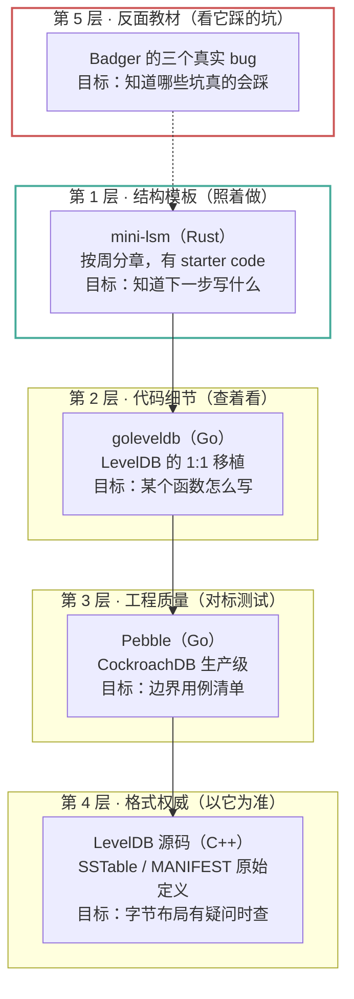

### 2.2 每层「读到什么程度」

| 层 | 项目 | 读法 | 读到什么程度 | 什么时候读 |
|---|---|---|---|---|
| 结构 | **mini-lsm** | 通读教程，跟着写 | 能复述每一周解决什么问题 | 开工前 + 每周开始时 |
| 细节 | **goleveldb** | 按需跳读 | 只看当前在写的那个文件 | 卡住时 |
| 质量 | **Pebble** | 只读 `*_test.go` | 抄测试用例，不抄实现 | 模块写完后 |
| 格式 | **LevelDB** | 只查 `table/`、`db/version_edit` | 字节布局以它为准 | 写 `block.mbt` / `sstable.mbt` / `manifest.mbt` 前 |
| 反面 | **Badger** | 读 issue 与修复 commit | 记住三个坑 | 设计 compaction 前 |

### 2.3 为什么主模板是 mini-lsm 而不是 LevelDB

| 维度 | mini-lsm | LevelDB |
|---|---|---|
| 学习曲线 | 有分周教程，每章有目标 | 无教程，需自己拼 |
| 代码量 | ~3000 行 Rust | ~20000 行 C++ |
| 抽象层次 | 适中，一个文件一个概念 | 重，有 `Env` / `Options` / `Iterator` 多层虚函数 |
| 现代性 | 用了 skiplist / bytes / crossbeam | 2011 年的 C++98 风格 |
| 与 MoonBit 的距离 | 中（都是 GC，但 Rust 有所有权） | 远（手动内存管理） |

关键判断：**mini-lsm 是「教学材料」，LevelDB 是「工业实现」。** 第一次写 LSM 需要的是前者——它告诉你「最小可用的 LSM 长什么样」，而不是「生产环境要考虑哪些 corner case」。后者是第 3 层（Pebble）的事。

### 2.4 mini-lsm 里不能抄的部分

它是 Rust，直接照搬会把 Rust 的约束带进来：

| mini-lsm 的写法 | MoonBit 里应该 |
|---|---|
| `Arc<MemTable>`、`Arc<RwLock<T>>` | 不需要，GC 直接共享引用 |
| `Send + Sync`、生命周期标注 `'a` | 不存在，删掉 |
| `crossbeam_skiplist` | 自己写跳表，或先用有序数组（当前选这个） |
| `bytes::Bytes` 零拷贝切片 | `Bytes` + 偏移量模拟，或接受拷贝 |
| 多层泛型 + trait bound | MoonBit trait 更轻，不要照搬抽象层次 |
| `impl Iterator for X` | MoonBit 迭代器协议不同，按语言习惯重写 |

**能抄的是**：数据结构选择、SSTable 布局、compaction 算法、测试用例设计、章节推进顺序。
**不能抄的是**：所有与所有权/并发/泛型相关的代码形态。

### 2.5 Badger 的三个真实 bug（答辩素材）

这三个都是**生产环境发生过**的、**有 issue 编号**的 bug。它们比「我实现了 LSM」有说服力得多，因为它们证明你知道 LSM 会在哪里坏：

**① Lbase 选层错误导致已删除数据复活**

Badger 的 LSM 有「Lbase」概念（最底层，数据从这里开始）。如果 compaction 时算错了 Lbase，墓碑会被合并到一个**比它原本更浅**的层，于是更底层的旧值重新变得可见——用户明明删了，重启后数据又回来了。

> 教训：**墓碑只能在最底层丢弃**。任何「提前丢墓碑」的优化都必须证明「该 key 在更深的层不存在」。

**② L0 背压忙等 10ms**

L0 文件数超阈值时，写入路径会阻塞等待 compaction。最初的实现是 `time.Sleep(10ms)` 轮询，导致高负载下写延迟出现规律的 10ms 毛刺。

> 教训：**背压要用条件变量/信号量，不要用 sleep 轮询**。这条在 MoonBit 里同样适用。

**③ 损坏 SSTable 的 footer 被清零后校验和变成 `0 == 0` 误通过**

SSTable 的 footer 存了校验和。如果磁盘把 footer 整段清零（比如掉电导致块全 0），那么「读取的校验和」和「重算的校验和」都可能是 0，于是 `0 == 0` 判定为通过，损坏文件被当成好的加载。

> 教训：**校验和之外必须有 magic number**。这就是 `docs/design/format.md` 里 footer 带 `"MSST"` 四个字节的原因——magic 是「这段数据是不是我以为的东西」，校验和是「它有没有被改坏」，两者不可互相替代。

---

## 3. 开发模型：为什么不用纯瀑布

### 3.1 五种模型的对比

用户提到瀑布模型。它确实是软件工程里最经典的模型，但对这个项目**不能直接用**。先看对比：

| 模型 | 核心思想 | 对这个项目的问题 |
|---|---|---|
| **瀑布** | 需求→设计→编码→测试→维护，逐阶段完成 | 前期要把设计定死，但 LSM 的格式细节是**写代码时才发现的**（我们真的在写 `Entry` 时才发现缺墓碑标记） |
| **V 模型** | 瀑布的变体：每个开发阶段对应一个测试阶段 | 思路对（需求阶段就想清怎么验收），但纯 V 仍然是一次性交付 |
| **增量** | 分批交付可用子集 | 对（Week 1/2/3 就是这个），但没有质量门禁，容易「先堆功能后补质量」 |
| **螺旋** | 每圈做风险分析，高风险先做原型 | 对高风险模块有效，但全项目都螺旋会过度设计 |
| **敏捷/Scrum** | 短迭代、响应变化 | 对「磁盘格式一旦发布不能改」这类约束不友好，且单人项目开 Scrum 会是自我表演 |

### 3.2 选定的模型：门禁式增量 V 模型（GIV）

```
GIV = V 模型的阶段映射（需求 ↔ 验收）
    + 增量的分批交付（M0–M4 里程碑）
    + 螺旋的风险优先（高风险模块先做 throwaway 原型）
    + 瀑布的门禁纪律（每个里程碑有硬性退出条件）
```

**为什么是这个组合**，逐条对应到本项目的真实约束：

**① 需要 V 模型的「左右映射」，因为崩溃一致性必须先定义验收方式**

ADR-0003 就是 V 模型左半边的产物：在写 WAL 之前，先写下「承诺什么、不承诺什么、怎么测」。如果先写代码再想怎么测，一定会写出「用 `kill -9` 测过了所以没问题」这种假合格证。

对应关系：

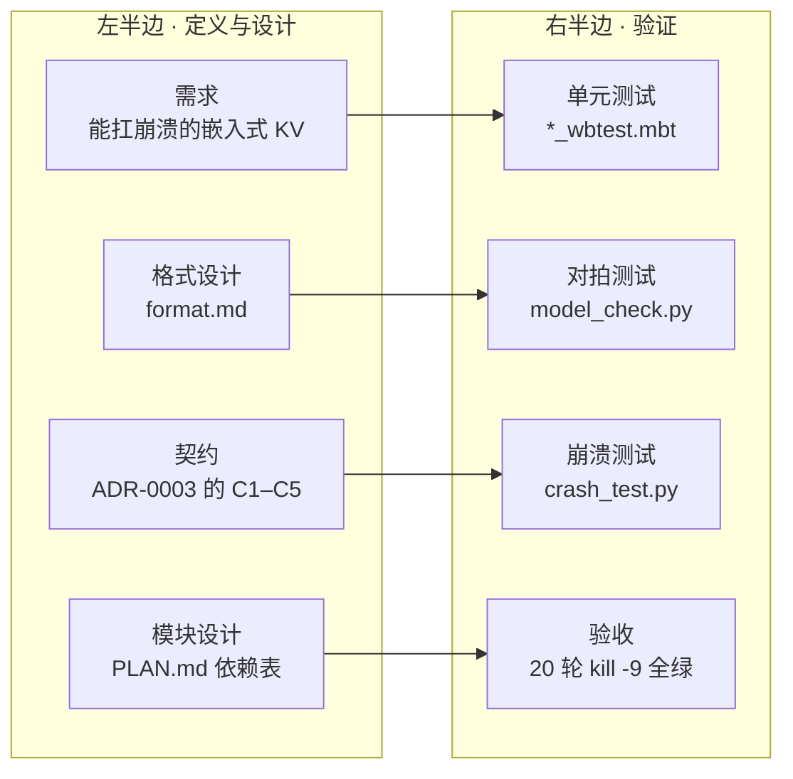

**② 需要增量，因为三周内不可能一次交付完整引擎**

M0–M4 五个里程碑，每个都能独立验收。Week 1 结束时引擎重启就丢数据——这是**允许的**，因为里程碑 M1 的验收标准里不包含持久化。把「允许不完整」写进计划，比假装能一次做完更诚实。

**③ 需要螺旋，因为 WAL 恢复和 compaction 是真正的高风险点**

这两个模块的特点是「写错了不一定报错，只在特定时序下丢数据」。所以它们各自先做一个**一次性的最小原型**（不求代码质量，只求验证想法），原型跑通再正式实现。

**④ 需要瀑布的门禁，因为存储引擎的返工成本是非线性的**

格式一旦发布就不能改（改了要 bump version + 迁移工具）。所以每个里程碑必须有明确的「退出条件」，不达标不进入下一阶段。这是瀑布唯一值得无条件继承的部分。

### 3.3 三条操作规则

**规则 1：门禁不过不进下一阶段，但同一阶段内允许自由迭代**

阶段内怎么试错都行（改设计、重写函数、换数据结构）。但跨阶段必须过门禁。这样既有瀑布的纪律，又不会被瀑布卡死。

**规则 2：高风险模块先做一次性原型**

判定「高风险」的三个信号：
- 出错时**不报错**，只是结果不对（如墓碑提前丢弃）
- 出错时**只在特定时序**暴露（如 fsync 顺序）
- 出错后**无法通过重跑复现**（如恢复时的半写记录）

命中任一 → 先写 100 行以内的原型验证思路，原型丢弃，再正式实现。

**规则 3：契约先于实现**

左半边的产物是**文档**，右半边的产物是**测试**。实现只是把两者接起来。判断是否违反这条：如果你在写代码时发现「这里该怎么处理」还没文档化，先停下来写文档。

> 这不是教条。本项目真的靠这条发现了缺陷：写 `types.mbt` 的测试时发现 `Entry` 没有墓碑标记，
> 于是回头改了 `format.md` 的 data block 布局。如果先写完 `sstable.mbt` 再发现，返工量是十倍。

### 3.4 GIV 的已知代价

诚实记录这个模型的缺点，避免把它当成银弹：

| 代价 | 表现 | 缓解 |
|---|---|---|
| 文档负担重 | 每个里程碑要写 ADR / 格式文档 | 只对**不可逆决策**写 ADR，不是每个函数都写 |
| 前期看起来慢 | 三周里有一周在写文档和测试 | 这部分是复利：格式文档让后续三个模块少踩坑 |
| 单人项目容易自我表演 | 一个人同时当开发、评审、QA，门禁容易自己放水 | 门禁条件必须是**机器可判定**的（CI 绿/红），不靠自我感觉 |
| 不适合需求频繁变化的场景 | 每次改契约要重走流程 | 本项目需求稳定（LSM 语义是教科书级的），不构成问题 |

---

## 4. 设计模型

### 4.1 分层架构

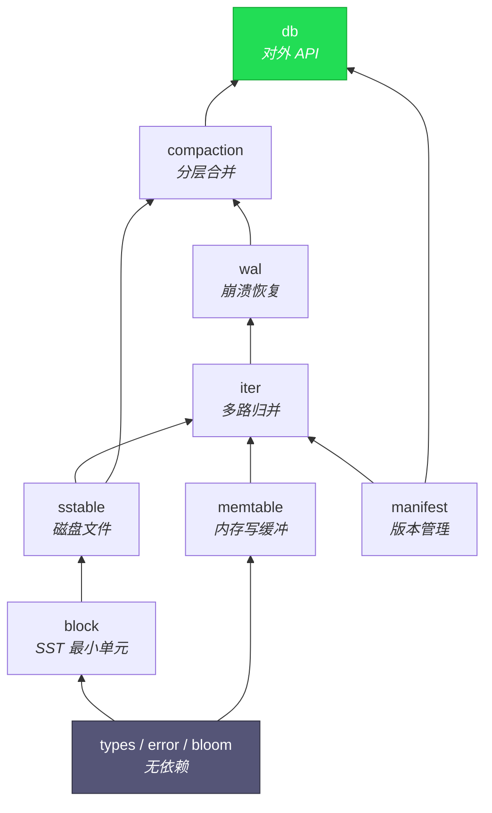

**关键约束：依赖严格单向，不允许反向或循环。**
MoonBit 同包内互调不会报错（见 ADR-0001），所以这条靠评审守，不靠编译器。

### 4.2 接口契约：只暴露 7 个方法

```moonbit
pub fn open(path : String, opts : Options) -> Db raise LsmError
pub fn put(self : Db, key : Key, value : Value) -> Unit raise LsmError
pub fn get(self : Db, key : Key) -> Value? raise LsmError
pub fn delete(self : Db, key : Key) -> Unit raise LsmError
pub fn scan(self : Db, start : Key, end : Key, limit : Int) -> Array[KvPair] raise LsmError
pub fn close(self : Db) -> Unit raise LsmError
pub fn fsync(self : Db) -> Unit raise LsmError    // 测试专用，生产不该暴露
```

**为什么边界要这么窄**：每多一个公开方法，就多一份「不能改」的承诺。`fsync` 之所以暴露，是因为 `dbcli` 的 `sync:true` 需要它——这是**为可测试性付出的 API 成本**，在 ADR 里应该有记录。

### 4.3 错误模型

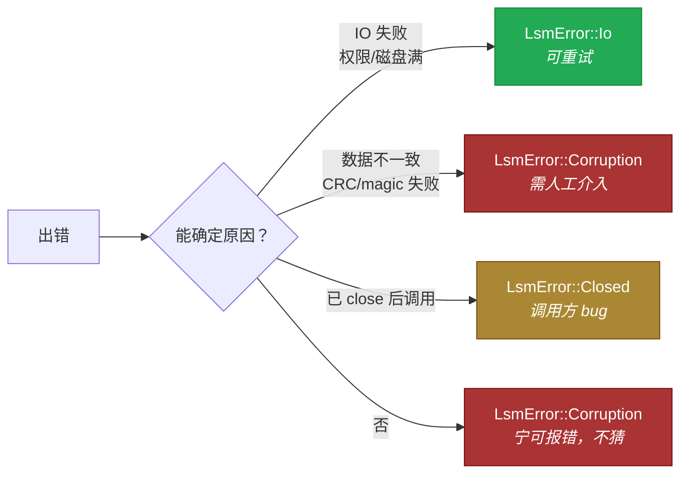

**三条硬规则**：
1. 恢复路径**禁止 panic**（ADR-0003 不变量 I3）
2. 错误信息必须含上下文（文件、偏移、期望值、实际值）
3. 分类不清时归入 `Corruption`——「拒绝启动」比「静默读错」安全

### 4.4 Db 生命周期状态机

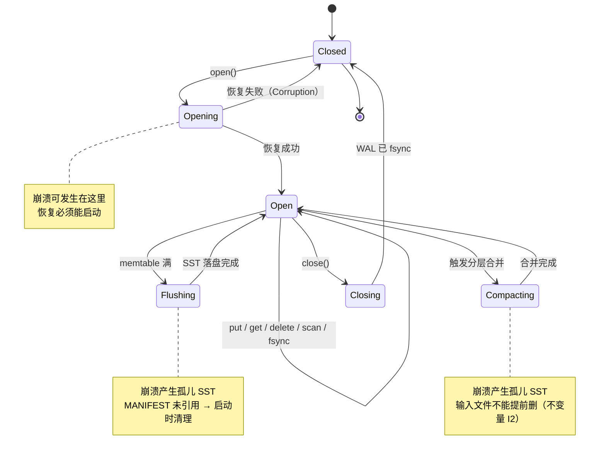

### 4.5 数据流：写路径

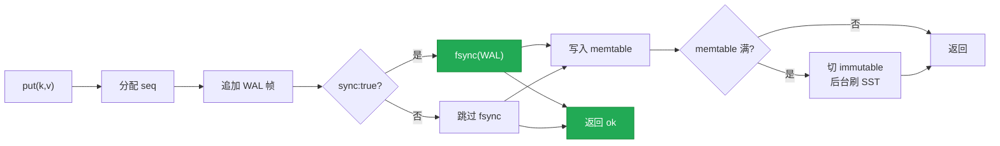

**这张图里最重要的一条边是 `E --> K`**：fsync 必须在返回 ok **之前**。反过来画（返回 ok 之后再 fsync）就是违约，而且 `kill -9` 测试抓不到——见 ADR-0003。

### 4.6 数据流：读路径

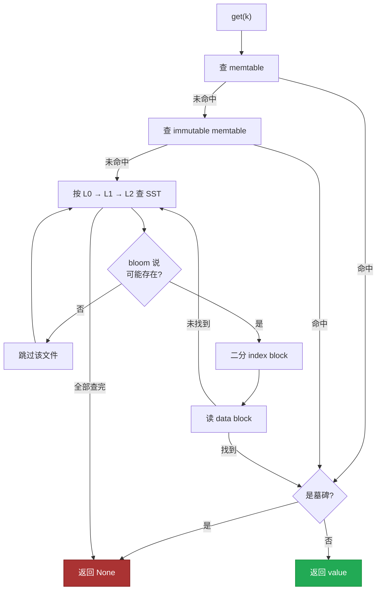

**bloom 的位置很关键**：它在「打开文件」之前。放错位置（先打开再查 bloom）就等于没做优化。

### 4.7 数据流：崩溃恢复

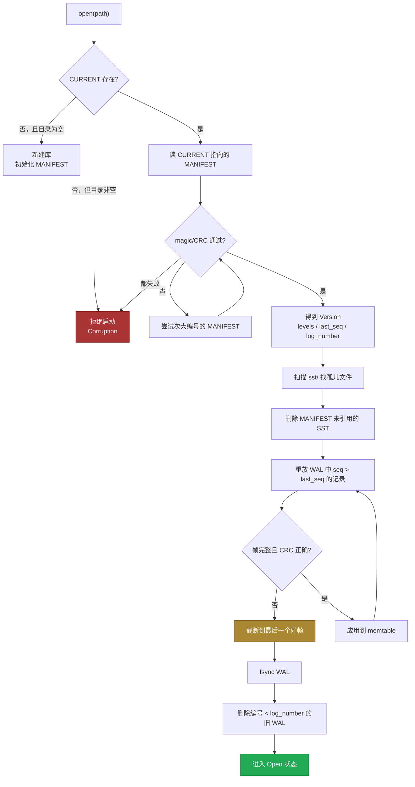

---

## 5. 流程图

### 5.1 GIV 开发流程（含门禁与回退）

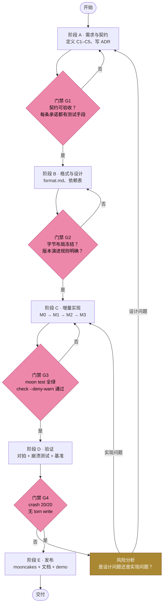

**四个门禁都是机器可判定的**（第 3.4 节说的「不靠自我感觉」）：
- G1：每条契约条款能对应到一个测试文件
- G2：format.md 有「已冻结」标记且 version 字段已定
- G3：`moon check --deny-warn` + `moon test` 退出码为 0
- G4：`crash_test.py --rounds 20` 退出码为 0

### 5.2 单模块迭代循环（阶段 C 内部）

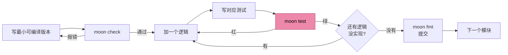

**为什么第一步是「最小可编译版本」**：MoonBit 的语法细节（`typealias` 废弃、字段要 `mut`、`Map::new()` 废弃）无法靠记忆保证正确。先让空壳编译通过，再往里填逻辑，每次报错只可能是逻辑问题，不会混着语法问题一起查。

### 5.3 里程碑依赖


**M2 是关键节点**：它之前「崩溃测试」没有意义（必然全红），它之后才有意义。这就是 CI 里 `probe_persistence.py` 存在的理由——显式跳过比假装跑过更诚实。

---

## 6. 从项目到产品：四阶段演进

这一节回答「项目够大之后还有很多考究」这个问题。核心判断：**项目、库、产品、平台是四种不同的东西，各自的成功标准不同。** 用项目的标准做产品，会做出一个「只有作者会用」的东西。

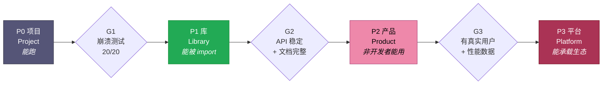

### 6.1 四个阶段的对照表

| | P0 项目 | P1 库 | P2 产品 | P3 平台 |
|---|---|---|---|---|
| **用户是谁** | 作者自己 | 其他 MoonBit 开发者 | 不写代码的人 / 其他语言的开发者 | 生态建设者 |
| **成功标准** | 能跑通、能演示 | 能被 `moon add` 后直接用 | 能解决一个具体问题，且有替代成本 | 别人在它上面做东西 |
| **必须有的** | 核心算法正确 | 稳定 API、semver、文档、错误信息可读 | CLI / 语言绑定、迁移工具、可观测性 | 插件机制、扩展点、SLA |
| **可以砍的** | 一切非核心 | 性能优化、高级配置 | 分布式、事务 | — |
| **典型失败模式** | 写不完 | API 天天改，用户不敢用 | 只有 demo，没有真实场景 | 过度设计，没人用 |
| **当前状态** | ✅ 已达（M0 完成） | ⬜ 目标（Week 3） | ⬜ 远期 | ⬜ 不承诺 |

### 6.2 每阶段要补的能力（按顺序，不能跳）

**P0 → P1：从「我的代码」到「别人的依赖」**

这一步的门槛不是功能，是**承诺**。一旦别人 `moon add` 了你的包，你的 API 就是契约。

| 要补的 | 为什么 | 判定标准 |
|---|---|---|
| semver 纪律 | 0.x 期间破坏性变更要标 BREAKING | CHANGELOG 有记录 |
| API 边界收窄 | 每多一个公开方法就多一份不能改的承诺 | 只暴露 7 个方法 |
| 错误信息可读 | 用户看不到你的源码，只能看错误信息 | 错误含文件/偏移/期望/实际 |
| 文档能让人上手 | README 首屏六块 | 陌生人 10 分钟内能跑通示例 |
| CI 门禁 | 别人信的是绿勾，不是你的自述 | 三平台 check + test 全绿 |

**P1 → P2：从「库」到「产品」**

门槛从「能调用」变成「能解决一个具体问题」。

| 要补的 | 为什么 | 判定标准 |
|---|---|---|
| 一个真实场景 | 「通用 KV 库」不是场景 | 能说清「谁在什么情况下非用它不可」 |
| CLI 或语言绑定 | 非 MoonBit 用户用不了 | `dbcli` 已具备雏形 |
| 迁移/导入工具 | 用户有存量数据 | 能从 JSON/CSV/SQLite 导入 |
| 可观测性 | 出问题要能查 | `stats` 返回有意义的指标 |
| 性能数据 | 「更快」需要证据 | 有 vs SQLite / moonkv 的对比表 |

**P2 → P3：从「产品」到「平台」**

这一步**不建议现在考虑**。平台化的前提是有足够多的用户产生了足够多样的需求，否则设计出来的扩展点全是想象出来的。

如果将来真的走到这一步，会需要的：
- 存储后端抽象（本地文件 / 对象存储 / 内存）
- 自定义 compaction 策略
- 多语言绑定（C ABI → Python/Node/Go）
- 崩溃一致性的形式化验证（不是测试，是证明）

### 6.3 为什么不在 P0 阶段就设计 P3 的东西

这是「过度设计」最常见的形式：在只有 1 个用户（自己）的时候，设计能支撑 1000 个用户的抽象。

具体的代价：
- 每层抽象都要写测试，测试量随抽象层数增长
- 抽象层会掩盖性能问题（你不知道慢在哪一层）
- 抽象错了要重构，而重构成本随代码量增长

**判断标准**：如果某个抽象当前只有**一个**实现，就不要抽象。等第二个实现出现，再抽。

本项目已经应用了这条：
- 不做 value log 分离（只有一个实现，没有对比）
- 不做压缩（format.md 留了 version 字段，将来能加）
- 不做 MVCC（Week 3 有余力再说）
- 不做多后端（`Db` 直接操作文件，没有 `Storage` trait）

### 6.4 「项目到产品」的真正分水岭

不是代码量，不是功能数，是这一条：

> **有没有人愿意为「不用它」付出成本。**

换句话说：如果别人可以 30 行代码自己写一个 dict + 文件追加来替代你，那你就还是项目。只有当「自己写」的代价（崩溃一致性、compaction、内存控制）显著高于「用你」的代价，产品才成立。

这也是为什么**崩溃一致性是本项目的核心卖点**：它是「自己写一个」最难跨过的那道坎。一个 `put` 就 `fwrite` 的实现 20 行就能写完，但要它能扛住 20 轮 `kill -9` 且不丢已确认写入，需要 WAL + CRC + 截断恢复 + MANIFEST 原子切换——这四样加起来就是本项目的全部价值。

---

## 7. 度量与门禁定义

把「做得好不好」变成数字，否则讨论会退化成感觉。

### 7.1 正确性指标

| 指标 | 定义 | 目标 | 当前 |
|---|---|---|---|
| 单元测试覆盖 | `moon test` 通过的测试数 | ≥ 30 | 16 |
| 对拍错误数 | `model_check.py` 报的错误条数 | 0 | 0（6 个种子） |
| 崩溃测试通过率 | `crash_test.py` 通过轮数 / 总轮数 | 20/20 | 未测（M2 前无意义） |
| torn write 次数 | 读出半条记录的次数 | 0 | 未测 |

### 7.2 性能指标

| 指标 | 定义 | 目标（参考值） |
|---|---|---|
| 顺序写吞吐 | `bench.py` 的 seq_write ops/s | 与 moonkv 同量级或更好 |
| 随机写吞吐 | `bench.py` 的 rand_write ops/s | 不低于顺序写的 70% |
| 读延迟 P99 | `bench.py` 的 read_p99 | < 1ms（本地 SSD） |
| 空间放大 | 磁盘占用 / 逻辑数据量 | < 1.5（leveled compaction） |
| 写放大 | 实际写入字节 / 逻辑写入字节 | < 10 |

**注意**：`sync:true` 与 `sync:false` 必须**分开报告**。只报快的那个是误导——两者差一个数量级是物理限制，不是实现问题。

### 7.3 工程质量指标

| 指标 | 定义 | 目标 |
|---|---|---|
| 编译警告 | `moon check --deny-warn` | 0 |
| CI 通过率 | 最近 20 次运行中通过的比例 | 100%（主干） |
| 文档覆盖率 | 公开 API 有 `///|` 注释的比例 | 100% |
| ADR 覆盖 | 不可逆决策有 ADR 的比例 | 100% |

### 7.4 门禁清单（可直接抄进 PR 模板）

```markdown
## 合并门禁

- [ ] `moon check --deny-warn` 退出码 0
- [ ] `moon test` 全绿，测试数未减少
- [ ] `moon fmt` 后无 diff
- [ ] 触及持久化 → `crash_test.py --rounds 5` 全绿
- [ ] 触及格式 → `format.md` 已更新 + version 已 bump
- [ ] 触及不可逆决策 → 新增 ADR
```

---

## 附：这份文档本身怎么维护

- **第 1、2 节**（命名与参考）在项目定位变化时更新，正常情况不动
- **第 3 节**（开发模型）只在「GIV 明显不适用」时重写，并开一条 ADR 记录为什么换
- **第 4、5 节**（设计与流程图）随架构变化更新，**必须与代码同步**
- **第 6 节**（演进路线）在每次跨越阶段时更新「当前状态」列
- **第 7 节**（度量）目标值可调，但指标定义不应随意改——改了就没法纵向比较
